 

 

## `~/about`

## `~/stack`

## `~/activity`

<!-- 
<picture>
  <source media="(prefers-color-scheme: dark)" srcset="https://raw.githubusercontent.com/Lonewolf230/Lonewolf230/output/github-snake-dark.svg">
  <source media="(prefers-color-scheme: light)" srcset="https://raw.githubusercontent.com/Lonewolf230/Lonewolf230/output/github-snake.svg">
  
</picture> -->

  
<!-- 
 -->

